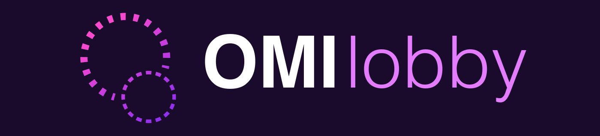

# service-omi-lobby



**Find a metaverse server you can join right now.**

Which space is open, and where do you go to join it?

A lobby for the open metaverse: one page that lists servers you can join now, across platforms. The working name is OMI Lobby; the final name is still open.

## Purpose

**One page lists the servers that are up.**

Spaces are hard to find across platforms.

OMI Lobby lists ready-to-join metaverse servers. We, the Open Metaverse Interoperability Group, hope this experiment makes spaces easier to find for everyone.

For each server the lobby shows its name, whether it is up, players online and capacity, its address, and its message of the day. It lists Basis servers and Overte domains today, and other platforms can follow.

To list a server here, reach out to the group. The lobby can poll any space that has a server address, and it does so every 10 minutes.

## How it works

**Uro polls every listed server every 10 minutes, and the site shows the list.**

Where does the list come from, and where does it live?

- Uro, the Phoenix API in this repository, polls every listed server every 10 minutes. Basis servers are the addresses in the `:lobby_basis_servers` setting, each asked for its status directly. Overte domains come from the public Overte directory.
- Uro holds the list in memory and replaces it whole on each poll, so the list adds nothing to the database. A domain that leaves the Overte directory drops off the list.
- The Next.js site in `frontend/` shows the list at `/` and counts down to the next poll. It reads the list from `GET /api/v1/lobby/servers` on the server side, so a browser never calls the API.

To run it yourself, follow Build and run below.

## Companion tray app

**Put the lobby in your Windows taskbar.**

Want the list without opening the page?

[interactor-omi-lobby-tray](https://github.com/V-Sekai-fire/interactor-omi-lobby-tray) puts the lobby in the Windows taskbar. Its tray icon reads `GET /api/v1/lobby/servers` every 10 minutes and lists the Overte domains and Basis servers that are up, with players online. Picking an Overte domain opens it in Overte through `hifi://`; picking a Basis server copies its address to paste into Basis.

Open interactor-omi-lobby-tray to try it.

## Code layout

**Seven folders, one for each side of the hexagon.**

Where does a new file go?

Uro follows the Netflix hexagonal layout, with the seven sides named as in the rest of the V-Sekai-fire repos. The Mix project keeps its usual shape: `mix.exs` at the root, code in `lib/`, config in `config/`, migrations in `priv/repo/migrations`, tests in `test/`.

```text
lib/uro/
  transport/    Phoenix web (endpoint, router, controllers, plugs) and the lobby poller
  contract/     behaviours (ServerProbe, ServerDirectory) and the OpenAPI specification
  interactor/   Lobby, Accounts, Passkeys, SecondFactor, DeviceGrant, SharedContent, ...
  entities/     Ecto schemas, Lobby.Server and pure support code
  repository/   the SQLite repo
  datasource/   the Basis UDP query and the Overte directory client
  service/      mail, Turnstile, tokens, uploads, telemetry, the Pow cache
  application.ex   the OTP application
```

Run `mix docs` and open `doc/index.html` for the details before you add a module; the `Uro` module has the layout.

## Build and run

**Two commands start Uro and the site.**

Want the lobby on your own machine?

Run Uro with its development database in a local file:

```sh
mix deps.get && mix ecto.setup && mix phx.server
```

Run the site with `pnpm install && pnpm dev` in `frontend/`.

`fly/` holds the Fly.io deploy: `fly/api` for Uro, with no public address, and `fly/web` for the site.

Run both, then open the site.

## Contributors

**Uro began as a copy of V-Sekai/uro.**

`git log` here shows only later work. These people wrote Uro and its web front end before the copy ([V-Sekai/uro](https://github.com/V-Sekai/uro)):

- [SaracenOne](https://github.com/SaracenOne)
- [fire](https://github.com/fire)
- [lyuma](https://github.com/lyuma)
- [ariesclark](https://github.com/ariesclark)
- [benbot](https://github.com/benbot)
- [dragonhunt02](https://github.com/dragonhunt02)

Dependabot also committed upstream. Work in this repository: [fire](https://github.com/fire). The lobby is an experiment of the [Open Metaverse Interoperability Group](https://omigroup.org/). The lobby page lists the same people; `Uro.Contributors` in `mix docs` says how to update both.

## Licence

MIT. See `LICENSE`. The rings are copied from the logo of the [Open Metaverse Interoperability Group](https://omigroup.org/).
